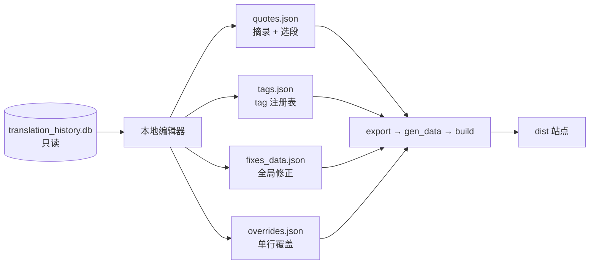

# EDITOR-PROPOSAL.md — 直播档案编辑器方案

> 状态：**P0 已实现**。把「逐字稿勾选生成摘录 / ASR 全局修正 / 单行改写 / tag 管理」从手改 JSON 与 Python 表，变成可视化编辑；不写数据库里的翻译记录（只在「拉取手机库」时追加 SC 与弹幕），也不动导出链路的权威性。
> 主入口与文档地图见 [AGENT.md](../AGENT.md)，校勘口径见 [EXCERPT_RULES.md](EXCERPT_RULES.md)、[WRITING-RULES.md](WRITING-RULES.md)。

## 启动

只要一条：

```bash
npm run editor     # 在 live-archive 根目录
```

首次在新机器上先 `npm install`（根）+ `npm run editor:install`（装 Electron，`.npmrc` 已指向国内镜像）。壳会自己起 Python 后端、等端口就绪再开窗；关窗时一并杀掉后端。端口已被占用则直接复用，不重复启动。

后端固定用仓库里的 `.venv`（Windows 是 `.venv/Scripts/python.exe`），并把 `VIRTUAL_ENV` / `PATH` 一起传下去——这样「重建站点」里由 `server.py` 用 `sys.executable` 再拉起的 `export.py`、`vite build` 走的是同一套依赖。`.venv` 不存在时退回 PATH 上的 `python`。

调试窗口：在 `editor/desktop` 里跑 `npm start -- --dev` 会额外打开 DevTools。

只有桌面窗口这一种形态，没有浏览器入口，也不需要任何 `.bat` / `.cmd`。后端 `editor/server.py` 是壳拉起的内部服务，只监听 127.0.0.1。

改完点「重建站点」才会进 `dist/`；编辑器本身不自动重建。写入前会把原文件备份到 `.state/editor-backups/`。窗口和页面图标是 `editor/icon.png`（与站内 favicon 同一张「火」图标）。

### 下播后的使用顺序

编辑器只读 `site/data/sessions/*.json`，**不会自己从 DB 导出新场次**，所以不是「开编辑器就能编辑」：

1. `python tools/export.py`，把新场次写进 `site/data/sessions/`。
2. `npm run editor`；左栏选场次。手机端刚采集完的话，先在上下文抽屉点「⇣ 拉取手机库」，把新 SC / 弹幕追加到本机 DB（手机需在线）。
3. 勾选逐字稿行生成摘录，引用块可选 **SC 或弹幕**（二选一），填 title / tag / note，保存。保存摘录只写 `quotes.json`；行内铅笔只写 `overrides.json`——**编辑器不会直接改 `site/data/sessions/*.json`**，只有点「重建站点」时 `export.py` 才把 overrides 套进 sessions。
4. 点「重建站点」（export → export_subs → gen_data → vite build）。只跑 `npm run build` 不会套用新的 overrides。
5. 日记仍手写 `site/data/diary.json`，编辑器目前不管日记；时间线由 diary / quotes / dynamics 自动生成，没有独立文件。

---

## 已实现（P0）

- **摘录**：选场次 → 勾选逐字稿行 → 填标题/tag/引用/note → 保存。引用块可以是 **SC 或弹幕二选一**（表单里切换），从上下文抽屉点对应行可直接填入。一条摘录可挂多个 tag（逗号分隔或点选）。已有摘录可重新载入勾选、修改、删除。引用原文用多行框（随内容长高，不再挤在一行里横向滚），下方「选段预览」会把引用与所选逐字稿行一起画出来，保存前就能核对。
- **场次树**：左栏按 `年 / 月 / 日 / 场次` 折成 VSCode 资源管理器的样式——每层 12px 缩进并画纵向参考线，行高 22px，折叠箭头 + 文件夹/时钟图标 + 右侧条数徽章，选中行整行高亮；折叠状态存 localStorage，切场次时自动展开它的上层目录（只在切换那一刻展开，所以「全部收起」不会被顶开）。**每层都单独成行，不做单链合并**：某个月只有一场也照样 `2026 → 11 → 26 → 00:14` 四层，层级关系不随数据变形。列头有两个图标按钮：全部展开 / 全部收起。
- **本场摘录列表**：编辑栏顶部一个可折叠分节（`本场摘录`），点头部折叠、状态存 localStorage。列出本场所有摘录（时间 / 标题 / tag），点一条即载入下方表单继续编辑，并把逐字稿滚到选段首行。面板高度可上下拖（见下条）。
- **栏宽 / 面板高度可调**：左栏 / 编辑栏之间各有一条 6px 的隐形分隔条，鼠标移上去亮一条橙线，拖动改宽度；上下文抽屉的左边缘同样能拖。编辑栏内部另有一条横向分隔条，拖动改「本场摘录」面板的高度（给下面表单留 ≥240px），**双击回到按条数自适应**。宽度存 localStorage（`lc-col-w`）、高度存 `lc-quote-h`。中间逐字稿始终保留 ≥240px，窗口变小时按可用宽度夹住显示、不覆盖你存的值。
- **摘录库**：全库摘录按日期倒序浏览，支持搜标题/正文/tag；点一条会切到它所属场次再载入表单。老条目没有 `session` 字段的，按 `date` + 时间窗反查场次。
- **兼容旧条目**：老摘录没有 `sel`，生成时仍按首末句圈段。在编辑器里点开时，后端按首行时间戳定位、按 `jp` 行数向后延伸，得出 `selDraft` 先把勾选画出来（状态栏标「推测选段」）；**只有点保存才会把它固化成真正的 `sel`**，此后逐行精确引用。推测不对就先调整勾选再存。
- **全局修正 = 全库搜索替换**：照 VSCode 的搜索框做——查询行带 `Aa`（区分大小写）与 `.*`（正则）开关，替换行有「全部替换」；`范围` 可选原文 + 译文 / 只原文 / 只译文。结果按场次分组，每条同时列出**原文（命中处高亮）**和**替换后**两行，右侧「应用」只改这一行，也可以一次替换全部。
  - 应用写的是 `site/data/overrides.json`（精确到某场某行，逐行可还原），不是全局规则，所以不会顺带改掉别处；匹配口径是「已导出的逐字稿」，改完规则要先重建才反映到搜索里。
  - 正则模式里替换串支持 `$1` / `${1}` / `$&`（按 VSCode 习惯写，后端转成 Python 的 `\g<n>`）；正则写错会直接在状态行报错，不会静默 0 命中。
  - 结果超过 800 行时列表只给前 800 行并标明，`全部替换` 也只处理列出的这些（避免一次误改全库）。本轮已应用的行标「已应用」并变灰，换搜索条件才重置。
  - 下面另有「存为全局规则」折叠区（`tools/fixes_data.json`）：一条规则作用于所有场次，**包括以后新导出的场次**。新增时先试跑 DB 原始记录命中数，命中 0 或串太短会拒绝；历史 `asr_fixes.py::FIXES` 只读保留，导出时两者一起生效。
- **逐字稿内搜索**：中间栏工具栏的放大镜（或 `Ctrl/Cmd+F`）在列表上方展开一条查找栏，照 VSCode「在文件中查找」的手感——输入即高亮全部命中（原文和译文都搜），右侧显示 `当前 / 命中行数`，`Aa` 区分大小写、`.*` 走正则（写坏直接在状态位报「正则错误」），`Enter` / `Shift+Enter` 或上下箭头在命中行之间跳，当前行整行压暗底 + 左侧橙条；`Esc` 关闭并清掉高亮。
  - **不过滤行**：列表始终是完整逐字稿，搜索时勾选、行内铅笔照常可用——过滤会丢掉上下文，也容易勾错相邻行。
  - 勾选某行会让列表整块重画，这里存了 `scrollTop` 再复原，高亮和当前位置都不会跳回顶部；换场次自动收起并清空关键词。
- **tag 管理**：新增 / 改名 / 合并 / 删除；改名和合并会同步改写所有引用它的摘录。
- **逐字稿单行修改**：每行右侧铅笔（hover 才显示）打开弹窗，可改日文原文与中文译文，**必须写「为什么改」**。存进 `site/data/overrides.json`，键是 `场次 / HH:MM:SS#同秒序号`（全库有 535 处同秒重复，只用时间戳会串行）。导出时它最后套，优先级高于 `FIXES`；字幕轨同时生效（改过的行会把 `timing` 索引补一条别名，避免丢掉「开口时刻+时长」）。改回原样就等于撤销，弹窗里也有「还原原文」。
- **复制逐字稿**：每行末尾 hover 出两枚小按钮，左边那枚只复制这一条；顶部工具栏的「复制选中 N」复制所有勾选行（没勾选时禁用，按钮上直接写条数）。格式统一是 `[时间] 原文` 换行译文、条与条之间空行，粘到笔记里还能对回录音。走 `navigator.clipboard`，不可用时退回 `execCommand`——只读文本，不碰任何数据。
- **上下文抽屉（SC + 弹幕）**：点逐字稿上方的「上下文 SC / 弹幕」在右侧展开本场**全部** SC 与弹幕，按时间排成一条时间线，自动滚到离选中行最近的一条并高亮，每行标出相对选中的偏移（`+27s` / `−4m25s`）。
  - 不再按 ±40 秒机械筛选：数据少就全列出来，多就分页（每页 200 条，`更早 / 更晚` 翻页，`回到选中` 一键回锚点）。
  - 顶部可切 `全部 / SC / 弹幕`。点击 SC 行直接把发送者和原文填进表单的 SC 字段，省得手抄。
  - 第三行是搜索框：按**内容、用户名、SC 译文**过滤本场全部记录，命中处高亮，标题旁显示 `命中 N / 总数`；搜索时从第一页开始，不按选中的逐字稿行定位（要找某一处时按 `回到选中` 或清空搜索即可）。换场次自动清空搜索。
  - 打开抽屉时主界面让出 460px，编辑表单仍可见（窗口窄于 1300px 时改为浮层覆盖）。
  - 本机没有当天的记录时，直接说明库里覆盖的日期范围，避免误以为「这场真的没弹幕」。
  - 抽屉右上角「⇣ 拉取手机库」：走 `ssh v20 python3 - | gzip`，手机端只读，本机只追加。按 `received_at` 水位增量拉（重叠 10 分钟），弹幕按（room_id, received_at, uid, text）去重、SC 按 `sc_id` 主键去重，重复点不会翻倍。点一次即可补齐到最新一场。

### 数据契约

| 文件 | 变化 |
|---|---|
| `site/data/quotes.json` | 新条目带 `session` / `sel`（`{i: 行号, t: 时间戳}`）/ `tags` / `title`；引用块 `sc` 或 `dm` 二选一；老条目原样保留 |
| `site/data/tags.json` | 新增，tag 注册表 |
| `site/data/overrides.json` | 新增，逐字稿单行覆盖（含 `why` 与 `orig`）；行内铅笔与全库搜索替换都写这里 |
| `tools/fixes_data.json` | 新增（编辑器创建），结构化全局修正 |
| `site/data/sessions/*.json` | 不写，由 `export.py` 产出 |
| `translation_history.db` | 不回写修正列；只有「拉取手机库」会**追加** SC / 弹幕（手机端只读） |

### 尚未做

- 回写 DB 的修正列（`CorrectedSourceText` 等）：用户未拍板，暂不改库。
- P1：重复摘录检测、草稿自动保存、撤销栈、快捷键。
- P2：重建后自动跑自检；代码签名与安装包（目前只是 Electron 壳，没做 `electron-builder` 打包）。

---

## 原始方案与评审记录（以下内容为设计阶段的方案，供追溯）

## 1. 现状与痛点

现有链路：`translation_history.db` → `tools/export.py` → `site/data/sessions/*.json` → `tools/gen_data.py` → `.build/public/` → `tools/build.py` → `dist/`。

人工维护的部分集中在三个地方：

| 内容 | 现在的做法 | 痛点 |
|---|---|---|
| 逐字稿译文 / ASR 修正 | 追加 `tools/asr_fixes.py::FIXES`，或手改导出的 `sessions/*.json` | 手改导出文件会被下次 `export.py` 覆盖；写表要开 Python 文件、想命中范围靠肉眼 |
| 摘录 | 手写 `site/data/quotes.json` 的 `jp/zh` 首末句，构建时靠 `topic_lines()` 模糊匹配圈段 | 边界漂移（串进闲聊、截在半句），每次都要重跑才知道圈对了没 |
| tag | 直接写在每条摘录的 `tag` 字符串里 | 改名/合并要全文替换，无注册表，不知道哪些 tag 已被使用 |

另外，校译时最可信的对照是手机库 `sc_message` 的观众原文，以前得手工查库；现在由编辑器的上下文抽屉直接列出本场全部 SC 与弹幕。

## 2. 形态选型

| 方案 | 优点 | 代价 | 结论 |
|---|---|---|---|
| A. VSCode 插件 | 编辑器/diff/git 都是现成的 | 勾选逐字稿、tag 管理仍要做 Webview；插件打包与激活链路额外一层；和 Python 工具链隔着进程 | 备选：后续可用同一套后端套壳 |
| B. Electron / Tauri 独立软件 | 完全独立的桌面体验 | 打包体积大、Tauri 还要 Rust 工具链；本质上还是内嵌浏览器 | 不推荐现在做 |
| **C. 本地独立编辑器（已采用）** | Python 标准库后端 + 本地页面 + Electron 壳，`npm run editor` 一条命令；可直接 `import` 现有 `tools/` 模块；三栏勾选交互最自然 | 壳本身要装一次 Electron（~100MB） | **已按这个做**；后端输出 JSON，将来可无痛套成插件 |

下面所有界面图示按方案 C 画。它不是网站，不联网、不部署，只在本地跑。

## 3. 数据流



**只写源文件，不写生成物**：`.build/`、`dist/`、原始 DB、`subs/index.json` 都不由编辑器直接改。重建按钮跑现有命令并回显日志；提交与推送仍由人工确认，不自动 push。

## 4. 数据契约改动（最小侵入）

1. **`site/data/quotes.json`**：每条可增加 `session`（场次文件名，消除同日两场歧义）与 `sel`（显式选段，元素为 `{t, n}`，`n` 是同时间戳内的第几条，通常 0）。保留 `jp/zh` 作为旧条目的首末句锚点；新增 `title`。
   - `tools/gen_data.py`：有 `sel` 时按 `session + t + n` 从逐字稿逐行取 `lines`，**不再模糊匹配**；没有 `sel` 的旧条目继续走 `topic_lines()`，行为不变。
   - 这样「勾选 → 摘录」是确定性的：页面上看到的每一行就是摘录里的每一行。
2. **`site/data/tags.json`（新增）**：tag 注册表（名称、顺序、备注）。前台筛选仍可按条数排序；注册表让「空 tag / 改名 / 合并」有处可依。
3. **`tools/fixes_data.json`（新增）**：结构化全局修正条目 `{bad, good, why, session, t}`。`tools/asr_fixes.py` 启动时读入并追加到 `FIXES`；**原有 Python `FIXES` 保留、只读展示**，历史条目不动。写入前校验：长串唯一命中、先试跑命中数、必须写校勘依据。
4. **`site/data/overrides.json`（新增）**：单行覆盖 `{session, ts, jp, zh, why}`，`ts` 用 DB 的 `Timestamp`（两代导出共用）。`tools/export.py` 与 `tools/export_subs.py` 在应用 `FIXES` 之后再套覆盖。
   - 用途区分：同一错词在多处出现 → 全局修正；只有这一行语气/措辞要改 → 单行覆盖。

## 5. 功能清单

### P0 — 核心闭环
- [x] 场次列表（按日期），逐字稿表格：时间戳 / 日文原文 / 中文译文 / 话题 / 勾选框
- [x] 勾选多行 → 生成摘录：填概括标题、选 tag、填校勘 note；预览确认后写入 `quotes.json` 的 `sel/title/tag`
- [x] 已有摘录可重新打开：改标题、改 tag、改选段、删除
- [x] tag 增删改：新增、重命名、合并到另一个 tag、删除（删除前显示受影响条数并二次确认）
- [x] 行内修正：日文/中文并排改；选择「全局修正」或「仅本行」；填校勘依据；保存前显示命中范围
- [x] 全库搜索替换：`Aa` / `.*` 开关、按行列出原文与替换后文本、单条应用或全部替换（写单行覆盖）
- [x] 上下文抽屉搜索：SC / 弹幕按内容与用户名过滤，命中高亮
- [x] 一键重建：export → export_subs → gen_data → build，日志原样回显；本地预览刷新
- [x] 所有写操作前原子落盘 + 备份 `.state/editor-backups/`

### P1 — 提效
- [x] 上下文抽屉：本场全部 SC + 弹幕一条时间线，按选中行就近定位、可翻页、可筛选，点 SC 填入表单
- 重复摘录检测：同场次相近时间、选段重叠时提示，避免重复收
- 摘录卡片实时预览（与站点同款：圆角 tag + 标题 + 逐行双语），可复制日文/中文
- 草稿自动保存、撤销栈、快捷键（J/K 上下、Space 勾选、Shift+点区间、E 修该行、Q 新建摘录、Ctrl+S 保存）
- Git 面板：只看相关文件的 `git status` 与 diff 摘要；提交需手填说明，不自动 push

### P2 — 封装与保障
- [x] Electron 桌面壳（`npm run editor`）
- 重建后可选跑 `.state/verify_ui.js` 自检（当前 59 项）
- 同一后端可包成 VSCode 插件 Webview（如果用户更想在 VSCode 里用）

## 6. 界面说明

- **主界面**：左场次、中逐字稿、右编辑抽屉；图示见对话中的「主界面三栏」。
- **生成摘录**：勾选后右侧切到「摘录」页，标题/tag/note 与选段预览同屏；图示见「摘录生成」。
- **修正面板**：旧文与新文并排、作用域二选一、命中范围与校勘依据；图示见「行内修正」。
- **tag 管理**：独立弹窗，列出使用数，支持改名/合并/删除；图示见「tag 管理」。

## 7. 安全与校验

- DB 一律只读连接；生成器产物目录不写。
- 修正写入前：命中数为 0 拒绝保存；短串（少于 8 字）警告；必须填 `why`；敏感词遮蔽规则自动套用（界面不展示规则内容，也不提示哪句被遮蔽）。
- 摘录写入前：选段非空、标题不超 40 字、tag 必须在注册表内、同场次重叠提示。
- 删除/合并：显示受影响条数、二次确认、先备份再写。
- 所有写入按 UTF-8 原样格式（`quotes.json` 保持现有 `indent=1`、LF），避免整文件 diff。

## 8. 验收口径

- 勾选 5 行生成摘录后，重建产物里的 `lines` 与勾选的 5 行时间戳、文字完全一致。
- 旧条目（无 `sel`）生成的摘录与改造前逐字一致。
- 全局修正 / 单行覆盖写入后，逐字稿与字幕轨同时反映，重跑 `export.py` 不产生二次变化。
- tag 重命名后，所有引用同步更新，前台筛选无旧 tag 残留。
- 自检脚本全绿，控制台无错误。

## 9. 待评审拍板

1. 形态：方案 C（本地独立编辑器）是否可接受？还是必须 VSCode 插件？
2. 摘录选段改为显式行引用（`sel`），旧条目保持兼容——是否接受修改 `quotes.json` schema？
3. 「全局修正」与「单行覆盖」拆两张表——是否符合你平时的校译习惯？
4. tag 是否允许多个（当前站点数据模型是单 tag，本期建议仍单 tag）？
5. 日记编辑是否纳入本期（建议暂不，先把逐字稿/摘录/tag 跑通）？
